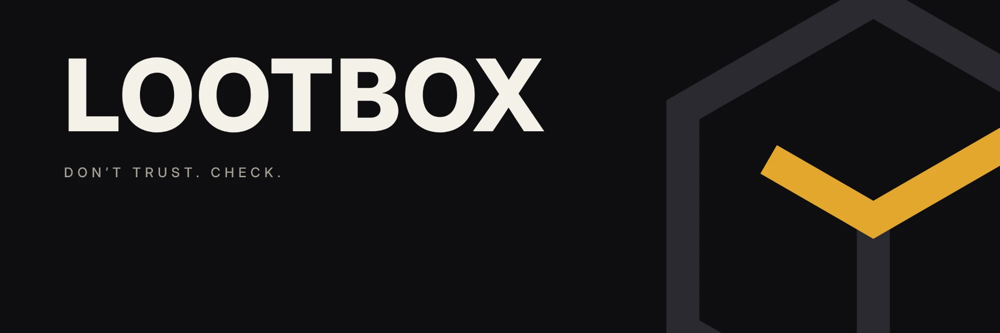
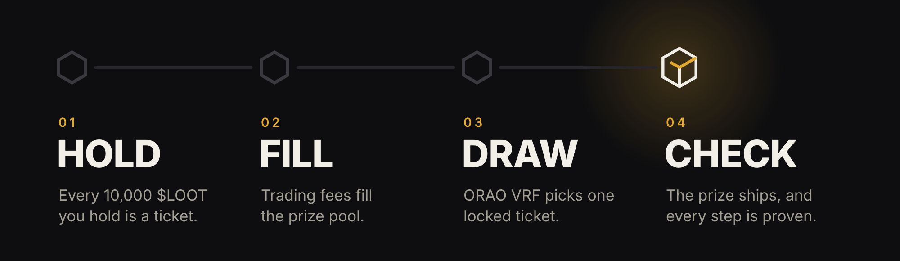

  <b>Prize drops for $LOOT holders on Solana.</b> 
  Trading fees fill a prize pool. When it's full, one ticket is drawn with verifiable randomness, 
  the prize is bought and shipped, and every step is published as a proof anyone can check.

  <a href="https://www.getlootbox.fun"><b>Website</b></a>
  &nbsp;·&nbsp;
  <a href="https://www.getlootbox.fun/docs"><b>Docs</b></a>
  &nbsp;·&nbsp;
  <a href="https://www.getlootbox.fun/proof"><b>Proofs</b></a>
  &nbsp;·&nbsp;
  <a href="https://www.getlootbox.fun/docs/verify"><b>Verify it yourself</b></a>

  
  

  
  
  

 

## Live on Solana

LOOTBOX runs at **[getlootbox.fun](https://www.getlootbox.fun)**, on Solana mainnet. This repository is the code behind it: the website, the drop engine, the draw, claims, ordering and the proof publisher. The live site is deployed straight from `main`.

| | |
|---|---|
| **Website** | The live prize pool, a coin for every trade, your ticket count, and every drop's proofs |
| **Drop engine** | Runs on its own, checking every drop once a minute |
| **Docs** | The full rules in plain language at [getlootbox.fun/docs](https://www.getlootbox.fun/docs) |

## Drop after drop

LOOTBOX isn't a one-off giveaway. It's a queue of drops, and every $LOOT trade keeps it moving.

| Drop | Prize | Prize pool |
|:-:|---|---|
| **001** | GTA VI Bundle: PS5 Pro, OLED monitor and GTA VI | $2,000 |
| **002** | Mystery Drop | $2,000 |
| **003 →** | Added to the queue as the drops ahead of it run | |

- **The next drop opens the moment the last one is drawn.** Nobody signs up again: keep holding $LOOT and you're in every drop.
- **Nothing is wasted between drops.** If a pool runs past its goal before the draw, the extra rolls into the next drop's pool.
- **Nobody has to run it.** Every minute the engine does whatever is due, from snapshots to the draw to the order, and after a crash or a slow reply it picks up where it stopped.
- **Every drop stays on the record.** Each one keeps its proof page, and its fingerprints stay on Solana, so the history only grows.

## How a drop works

- **Hold.** Every 10,000 $LOOT is one ticket, based on your average balance across random, unannounced snapshots taken while the pool fills.
- **Fill.** Every $LOOT trade pays creator fees into a public treasury on Solana. Each drop has a prize pool goal.
- **Draw.** When the pool fills, the ticket list's fingerprint is posted on Solana. Only then is ORAO VRF asked for the randomness that picks one ticket.
- **Check.** The prize is ordered through Zinc and shipped to the winner. Payment, order, delivery and receipt each get a proof.

## Don't trust. Check.

Every drop leaves eight proofs. Steps 1 to 4 happen on Solana, so the transaction is the evidence. Steps 5 to 8 happen off-chain, so each becomes a proof package that links to the one before it, with its fingerprint posted on Solana. Nothing can be changed quietly afterward.

| | Step | Proven by |
|:-:|---|---|
| 1 | **Funded** | Fee transactions into the treasury |
| 2 | **Paid** | One transaction that swaps the goal to USDC and pays the purchasing account |
| 3 | **Drawn** | Snapshot and ticket list fingerprints on Solana, plus the ORAO VRF result |
| 4 | **Claimed** | A fingerprint of the winner's address, posted once the winning wallet signs |
| 5 | **Ordered** | A zkTLS proof of Zinc's own order response, and the USDC payment to Zinc on Solana |
| 6 | **Shipped** | A zkTLS proof of Zinc's tracking record |
| 7 | **Delivered** | The same, once every package has arrived |
| 8 | **Received** | A message signed by the winning wallet |

The [proof page](https://www.getlootbox.fun/proof) re-runs these checks in your browser, and [Reproduce a draw](https://www.getlootbox.fun/docs/reproduce) shows how to re-run the pick yourself.

**Privacy.** The winner's name, address, phone and email are never published. Only a salted fingerprint of the address goes on-chain, and only the winner can check it. LOOTBOX keeps the address privately until the prize arrives, then deletes it.

## How it's built

LOOTBOX is one Next.js app on Vercel: the website, the docs, the proof pages and the drop engine. Every minute a scheduler wakes the engine, which looks at every drop, does whatever step is due, and saves. Steps that wait on outside services, like buying and shipping the prize, move forward one small step per tick and save as they go, so after a crash or a slow reply the next tick picks up where the last one stopped.

| Piece | What LOOTBOX uses it for |
|---|---|
| **Solana** | The treasury, the locked ticket list, the draw, and a Memo for every proof fingerprint |
| **pump.fun** | $LOOT is a pump.fun coin created from the treasury wallet, so every trade pays the treasury a creator fee |
| **Helius** | Sends every $LOOT trade to the site, and reads every holder's balance for snapshots |
| **ORAO VRF** | The randomness for each draw, with a proof that's checked on-chain |
| **Jupiter** | Swaps the prize's worth of SOL to USDC the moment the pool fills |
| **Shopify** | A $0 checkout where the winner enters their address, so it never passes through LOOTBOX's site |
| **Zinc** | Buys the prize from the retailer, paid in USDC on Solana from the purchasing account, and follows it to the winner's door |
| **Reclaim zkFetch** | zkTLS proofs of Zinc's order and tracking records |
| **Supabase** | The engine's state, and the private table that holds the winner's address until it's deleted |

## Read the code

You don't have to take the docs' word for it. These are the files that decide who wins and what gets published, in the order a drop uses them.

| To check | Read |
|---|---|
| The drop queue, and what each prize is | [`lib/engine/drops.ts`](lib/engine/drops.ts), [`lib/config/prizes.ts`](lib/config/prizes.ts) |
| How holdings become tickets | [`lib/draws/tickets.ts`](lib/draws/tickets.ts), [`lib/draws/snapshot.ts`](lib/draws/snapshot.ts) |
| Why nobody knows when a snapshot will happen | [`lib/engine/schedule.ts`](lib/engine/schedule.ts) |
| The engine's rules: when each step of a drop is due | [`lib/engine/decide.ts`](lib/engine/decide.ts), [`lib/engine/run.ts`](lib/engine/run.ts) |
| How fees reach the treasury and the prize is funded | [`lib/treasury/`](lib/treasury) |
| Why a draw's randomness can't be re-rolled | [`lib/chain/vrf.ts`](lib/chain/vrf.ts) |
| How the VRF result picks one ticket | [`lib/draws/weighted-pick.ts`](lib/draws/weighted-pick.ts) |
| How a winner proves they own the wallet | [`lib/claims/claims.ts`](lib/claims/claims.ts) |
| How the address fingerprint is made | [`lib/proofs/commitment.ts`](lib/proofs/commitment.ts) |
| How the prize is ordered, paid for and tracked | [`lib/orders/order.ts`](lib/orders/order.ts), [`lib/orders/x402.ts`](lib/orders/x402.ts), [`lib/orders/delivery.ts`](lib/orders/delivery.ts) |
| What each order proof reveals and hides | [`lib/orders/redact.ts`](lib/orders/redact.ts) |
| The guard that stops an address leaking into a proof | [`lib/proofs/pii-guard.ts`](lib/proofs/pii-guard.ts) |
| How proofs are chained and fingerprinted | [`lib/proofs/package.ts`](lib/proofs/package.ts), [`lib/chain/memo.ts`](lib/chain/memo.ts) |
| The checks the proof page runs in your browser | [`lib/proofs/verify-live.ts`](lib/proofs/verify-live.ts) |
| The database tables | [`supabase/migrations/`](supabase/migrations) |

Every page and API route is under [`app/`](app).

 

  <a href="https://www.getlootbox.fun">
    <picture>
      <source media="(prefers-color-scheme: dark)" srcset=".github/assets/logo-dark.svg">
      
    </picture>
  </a>
   
  Don't trust. Check.
   
  © LOOTBOX. The source is public so anyone can check it. All rights reserved.

