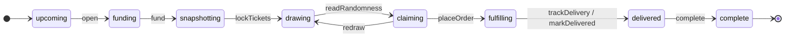
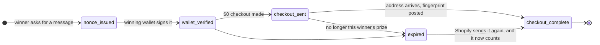

# State machines

Everything in LOOTBOX that moves through steps, in one place: what the steps are, the file that names them, what moves them on, and what stops a wrong move. If you're changing how a drop, a claim or an order behaves, start here.

There are two kinds, and they're kept apart on purpose.

- **Named statuses.** The thing has a status with a name, and one file lists the names and the moves allowed between them. Everything else reads that file. The drop's stage, a claim's status and the page states in the browser work this way.
- **The row is the state.** Buying, shipping and signing each take several outside calls, and any of them can fail halfway. These keep no status of their own. Each column is written the moment its step is done, so the row itself says how far things got, and a crash can never leave a saved status that disagrees with what really happened. The next tick reads the row and does the next missing step.

To see where every drop stands right now, what it's waiting on, and what the engine would do next:

```bash
npm run engine:status
npm run engine:status -- --json
```

It only reads. It never ticks, saves or takes the engine's lock, and it never prints a snapshot time.

## 1. The drop

| | |
|---|---|
| **Named in** | [`lib/engine/stages.ts`](lib/engine/stages.ts): `STAGES`, `FLOW`, and the groups (`isLive`, `isPoolFull`, `isDrawn`, `isOrdered`, `isDelivered`) |
| **Saved in** | the engine's private state (`engine_state`), mirrored to the public `drops.status` |
| **Moved by** | the engine only: [`decide()`](lib/engine/decide.ts) says which step is due, [`apply()`](lib/engine/decide.ts) says what it changes, [`tick()`](lib/engine/run.ts) runs it and saves |
| **Guarded by** | `flowProblem()`: a step is refused before it runs if the drop isn't in one of its stages, and again after if it would leave the drop anywhere `FLOW` doesn't allow. One tick at a time (the lock) |



| Step | Runs while the drop is | Leaves it in | Due when |
|---|---|---|---|
| `open` | upcoming | funding | every drop before it is drawn, and its opening time has come |
| `snapshot` | funding, snapshotting | the same | a private random time has come; once more the moment the pool fills |
| `fund` | funding | snapshotting | the pool has reached the goal (fees are collected first if the treasury alone can't pay) |
| `lockTickets` | snapshotting | drawing | the final snapshot is taken |
| `requestRandomness` | drawing | the same | the pause after the pool filled is over |
| `readRandomness` | drawing | claiming | every tick, until ORAO's answer is on-chain |
| `redraw` | claiming | drawing | the claim deadline passed with no claim |
| `placeOrder` | claiming | fulfilling | the winner's claim is finished; every tick until the order is placed, proven and fingerprinted |
| `trackDelivery` | fulfilling | delivered | every tick, until every package is delivered, proven and fingerprinted |
| `markDelivered` | fulfilling | delivered | `deliveredAt` was set by hand |
| `complete` | delivered | complete | the winner signed a receipt, or 14 days passed without one |
| `collect`, `alert` | any | the same | fees are waiting; something needs telling |

Within a stage, timestamps say how far the drop has got: `randomnessRequestedAt` (asked, not yet answered), `claimedAt` (claimed, not yet ordered), `deliveredAt`, `receivedAt`.

Three things reach a drop from outside the engine's own steps. None of them writes the engine's state directly:

- **A finished claim.** The Shopify webhook writes the `claims` table. The engine reads it at the start of each tick, while it holds the lock, and sets `claimedAt` ([`lib/engine/claims.ts`](lib/engine/claims.ts)).
- **A signed receipt.** The receipt route writes the `receipts` table, and the engine sets `receivedAt` the same way ([`lib/engine/receipts.ts`](lib/engine/receipts.ts)).
- **The queue.** A drop that hasn't opened yet follows [`lib/engine/drops.ts`](lib/engine/drops.ts) for its goal and opening time. From the moment it opens, its record is never changed from there.

**Hold** sits across every stage. A drop with `hold` set is skipped entirely until a person clears it. The engine sets it when carrying on would be unsafe: no tickets in the box, a price over its cap, an order or delivery that failed.

## 2. A claim

| | |
|---|---|
| **Named in** | [`lib/claims/status.ts`](lib/claims/status.ts): `CLAIM_STATUSES`, `CLAIM_FLOW`, `comesFrom()` |
| **Saved in** | the private `claims` table (`status`) |
| **Moved by** | the winner's signature ([`/api/claims/verify`](app/api/claims/verify/route.ts)) and Shopify's order webhook ([`lib/claims/complete.ts`](lib/claims/complete.ts)) |
| **Guarded by** | every write of a new status is limited to rows in a status it may come from, so two requests racing can't use a nonce twice or un-finish a claim. The database allows one finished claim per drop |



`CLAIM_FLOW` also lets a `wallet_verified` claim finish directly, for the case where the checkout was made but saving its link failed.

Finishing a claim is itself several steps, kept the second way: the address is saved with its salt (`claim_addresses`), the fingerprint post is reserved for one request at a time (`memo_started_at`, which frees itself after two minutes), the fingerprint is posted (`address_memo_tx`), and only then is the status set to `checkout_complete`. Shopify retries until it gets a 200, and every step is safe to repeat.

## 3. The order

| | |
|---|---|
| **Steps in** | [`lib/orders/order.ts`](lib/orders/order.ts), one small step per tick |
| **Saved in** | the private `orders` row. The row is the state |
| **Named in** | [`lib/orders/phase.ts`](lib/orders/phase.ts) `orderPhase()`, for status output only |
| **Guarded by** | the row is saved with its idempotency key before Zinc is asked for anything; one row per drop in the database; price caps checked before sending and again on Zinc's total |

`saved → sent → placed → proven → fingerprinted`, or `failed` / `cancelled`, which put the drop on hold.

| Phase | The row has | Next |
|---|---|---|
| saved | an idempotency key, no `zinc_request_id` | send the order to Zinc |
| sent | `zinc_request_id`, `status` not yet `placed` | read Zinc's status |
| placed | `status = placed` | make the zkTLS proof and check it for personal details |
| proven | `proof_hash` | post its fingerprint |
| fingerprinted | `memo_tx` | done: the drop moves to `fulfilling` |

Paying for it in USDC is a short exchange inside one call ([`lib/orders/x402.ts`](lib/orders/x402.ts)): send unpaid and get Zinc's price, check the price against the cap, sign a transfer for exactly that, send again with the payment. A repeat with the same key is answered with the existing order and is never charged twice.

## 4. The delivery

| | |
|---|---|
| **Steps in** | [`lib/orders/delivery.ts`](lib/orders/delivery.ts), one small step per tick |
| **Saved in** | the same private `orders` row |
| **Named in** | `ShipmentState` in that file (all of an order's packages as one state), and `milestonePhase()` in [`lib/orders/phase.ts`](lib/orders/phase.ts) |

The packages: `awaiting_tracking → pending → in_transit → delivered`, with `available_for_pickup` and `undeliverable` on the way. Delivered means every package is.

Two milestones are proven, `shipped` and then `delivered`, and each goes `waiting → seen → proven → fingerprinted` through its own three columns (`_at`, `_proof_hash`, `_memo_tx`). `shipped` is skipped if Zinc never reports a package moving before it's delivered.

## 5. The receipt

[`lib/claims/received.ts`](lib/claims/received.ts), in the public `receipts` row. The row is the state: the signed message is saved, then its proof package (`proof_hash`), then its fingerprint (`memo_tx`). Sending the same signature again finishes whatever a crash left undone. Once the fingerprint is posted the engine marks the drop received, which completes it.

## 6. A draw round

One row in `draw_rounds` per round: requested (`request_tx`), answered (`randomness_hex`), winner saved (`winner_wallet`, `result_memo_tx`). The seed comes from the drop, its locked ticket list and the round number, so a retry always asks for the same randomness account and reads the same answer ([`lib/chain/vrf.ts`](lib/chain/vrf.ts)).

## 7. The engine itself

- **The lock.** Free, or held with a 55-second lease that frees itself if a tick dies ([`lib/engine/supabase-store.ts`](lib/engine/supabase-store.ts)).
- **Alerts.** Each has a key, and a sent key is remembered (`sentAlerts`), so every alert goes out once.
- **Failing steps.** A step that throws waits for the next tick. One that has failed on every tick for 10 minutes is alerted once (`failingSince`).

## 8. In the browser

| What | Where | States |
|---|---|---|
| The homepage's stage | [`lib/live/fromView.ts`](lib/live/fromView.ts) holds every move; [`useLiveDrop`](lib/live/useLiveDrop.ts) only keeps time | `filling → funded → drawing → winner → filling` |
| The claim page | [`app/claim/ClaimForm.tsx`](app/claim/ClaimForm.tsx), worked out in one place (`step`) | `sign → checkout → claimed`; an expired claim goes back to `sign` with the reason |
| The proof checks | [`components/ProofChecks.tsx`](components/ProofChecks.tsx) | reading Solana and Reclaim: `loading`, `ready`, `failed`. Each check: `pass`, `fail`, `pending`, `checking`, `unchecked` |
| The eight proof steps | [`lib/live/types.ts`](lib/live/types.ts) `PROOF_STEPS` | `funded → paid → drawn → claimed → ordered → shipped → delivered → received`, read from when each was proven |

The receipt page, the ticket check and the wallet connect are each a form with a busy flag and one message. They're small enough to read in full where they are.

## Changing one

- **A new drop stage** goes in `STAGES`, `FLOW` and the labels in `lib/engine/stages.ts`, and in a migration for the database's `drop_status`. The type checker then points at everything else that has to know about it.
- **A new claim status** goes in `CLAIM_STATUSES` and `CLAIM_FLOW`, and in a migration for `claim_status`.
- **Never add a status column where the row can say it.** For anything that calls the outside world, write the result the moment it comes back and let the next tick read the row.
- **Every write of a status names the statuses it may come from**, as the claim writes do with `comesFrom()`.
